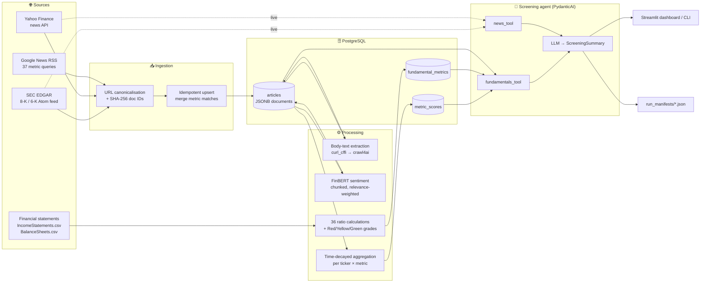
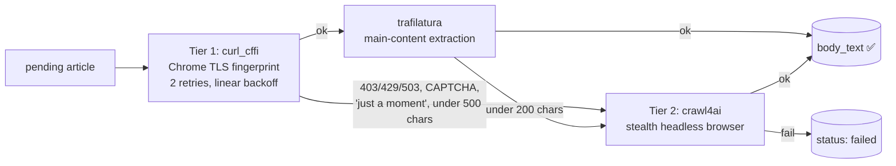
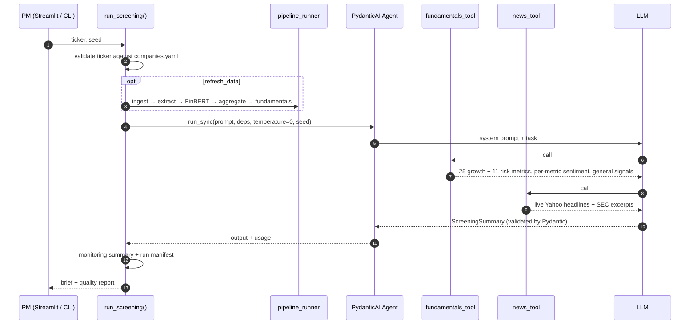

<div align="center">

# 📈 Equity Research AI

**An end-to-end equity screening system. It ingests SEC filings and financial news, scores them with FinBERT, computes 36 fundamental ratios from financial statements, and hands everything to a two-tool LLM agent that writes a screening brief for a Portfolio Manager.**


[What it does](#-what-it-does) · [Architecture](#-architecture) · [Quickstart](#-quickstart) · [Technical deep dive](#-technical-deep-dive) · [Agent design](#-the-screening-agent) · [Limitations](#-known-limitations--roadmap)

</div>

---

## 🎯 What it does

A Portfolio Manager picks a ticker. A few minutes later they get a structured brief that answers four questions:

| # | Question | Grounded in |
|---|----------|-------------|
| **Q1** | Is this company relevant to a **growth strategy** right now? | 25 growth fundamentals, each paired with sentiment from news matched to that metric |
| **Q2** | What are the **key positives and negatives** in recent news? | Live Yahoo Finance headlines and recent SEC 8-K / 6-K exhibits |
| **Q3** | What are the **financial highlights**? | Graded ratios for growth, profitability, capital efficiency and leverage |
| **Q4** | Are there **obvious risks or concerns**? | 11 risk fundamentals plus company-level news and filing signals |

> [!IMPORTANT]
> The agent never gives a buy, sell or hold call. Its verdict is limited to `Potentially relevant`, `Not clearly relevant` or `Insufficient data`. A separate evaluation step checks every output for recommendation language.

**Companies covered** (set in [`config/companies.yaml`](config/companies.yaml)): MercadoLibre (`MELI`), Global-E Online (`GLBE`), Adidas (`ADS.DE`) and Bridgestone (`5108.T`). US and foreign SEC filers sit alongside non-EDGAR names.

---

## 🏗 Architecture



The system runs as two layers:

1. **Data pipeline** ([`main.py`](src/equity_pipeline/main.py)): batch stages that can be run independently and safely re-run. They fill Postgres with raw documents, extracted text, sentiment scores, aggregated metric scores and graded fundamentals.
2. **Agent layer** ([`agent/`](src/equity_pipeline/agent/)): a PydanticAI agent with **exactly two tools**. It can optionally refresh the pipeline for one ticker before it answers.

---

## 🚀 Quickstart

### 1. Prerequisites

- Python **3.10+** (developed on 3.13)
- PostgreSQL 14+ (any version with `JSONB` and GIN indexes)
- An **OpenAI-compatible** LLM endpoint and API key
- Optional: a CUDA GPU. FinBERT then switches to FP16 automatically; it runs on CPU otherwise.

### 2. Install

```bash
git clone https://github.com/aks861999/Equity-Research-AI.git
cd Equity-Research-AI
python -m venv .venv && source .venv/bin/activate   # Windows: .venv\Scripts\activate

pip install -r requirements.txt -r requirements-agent.txt
crawl4ai-setup        # installs the headless browser for the fallback fetcher
```

### 3. Configure

Copy [`.env.example`](.env.example) to `.env` in the repo root and fill it in:

```dotenv
# PostgreSQL
POSTGRES_HOST=localhost
POSTGRES_PORT=5432
POSTGRES_DB=equity_research
POSTGRES_USER=postgres
POSTGRES_PASSWORD=change_me

# Any OpenAI-compatible endpoint
MANAGED_LLM_API_KEY=sk-...
LLM_BASE_URL=https://your-llm-endpoint/v1
LLM_MODEL=MiniMaxAI/MiniMax-M2.5

# SEC EDGAR contact, sent as the User-Agent
SEC_USER_AGENT="Your Name your.email@example.com"
```

> [!NOTE]
> The pipeline creates its tables on first run. If you have the database backup, restore it instead of ingesting from scratch:
> `pg_restore -d equity_research data/equity_research_backup.dump`

> [!WARNING]
> SEC EDGAR rejects requests without a real contact in the `User-Agent` header. Set `SEC_USER_AGENT` to your own name and email, or the SEC steps will return nothing.

Financial statement CSVs (`IncomeStatements.csv`, `BalanceSheets.csv`) go in `data/`. They are git-ignored because they come from a licensed data vendor. Expected format:

- **Income statement:** one row per `BB_Ticker` × `Year_` (2023–2025), with one column per line item, e.g. `NET SALES OR REVENUES (1001)`.
- **Balance sheet:** one row per `BB_Ticker` × line item (`index`), with `2025` and `2024` columns holding values such as `23494920.18 MM`.

### 4. Run

```bash
# Dashboard (recommended)
streamlit run streamlit_app.py

# Or the CLI: prints the brief, monitoring stats and quality checks
python run_screening.py --ticker MELI
python run_screening.py --ticker GLBE --no-refresh       # use what's already in Postgres (fast)
python run_screening.py --ticker MELI --no-google-news   # refresh everything except the slow Google News step
```

<details>
<summary><b>Running pipeline stages individually</b></summary>

<br/>

Every stage is idempotent, so re-running one only processes what is new or pending.

```bash
export PYTHONPATH=src          # PowerShell: $env:PYTHONPATH="src"

python -m equity_pipeline.main --ticker MELI             # ingest SEC + Yahoo for one ticker (omit --ticker for all)
python -m equity_pipeline.main --run-extraction          # fetch body text for every pending article
python -m equity_pipeline.main --run-sentiment           # FinBERT-score every extracted, unscored article
python -m equity_pipeline.main --run-aggregation         # build metric_scores
python -m equity_pipeline.main --run-fundamentals        # 25 growth ratios from the CSVs
python -m equity_pipeline.main --run-risk-fundamentals   # 11 risk ratios from the CSVs
python -m equity_pipeline.main --run-summary             # standalone LLM news summary per company

python -m equity_pipeline.read_example --ticker MELI     # read back what was ingested
```

</details>

---

## 🔬 Technical deep dive

### Stage 1: Multi-source ingestion

<table>
<tr><th>Source</th><th>Scope</th><th>What's interesting</th></tr>
<tr>
<td><b>SEC EDGAR</b><br/><a href="src/equity_pipeline/sources/sec_edgar.py"><code>sec_edgar.py</code></a></td>
<td>Company-level</td>
<td>
Reads the EDGAR Atom feed, parses each filing's index page and prefers <code>EX-99</code> exhibits (press releases) over the primary form.
Unwraps the <b>inline-XBRL viewer</b> iframe to reach the real document and strips <code>ix:*</code> tags, tables and hidden elements.
A <b>token-level digit-density heuristic</b> drops numeric fragments hidden in 1pt-font blocks.
Filings are treated as immutable: if a section is already stored, it is never downloaded again.
</td>
</tr>
<tr>
<td><b>Google News</b><br/><a href="src/equity_pipeline/sources/google_news.py"><code>google_news.py</code></a></td>
<td>Per-metric</td>
<td>
37 query templates in <a href="config/metrics.yaml"><code>metrics.yaml</code></a>, one per metric, with the company name substituted in.
The search window <b>widens adaptively</b> (<code>when:1m → 3m → 1y</code>) when a query returns fewer than 2 results.
Links are <b>deduplicated before decoding</b>: one earnings story typically matches 8–10 metric queries, so collapsing on the raw redirect link first cuts slow <code>gnewsdecoder</code> calls by about 5–10×. That turns a run of roughly 6 hours into minutes. The database is also checked so previously decoded links are skipped.
</td>
</tr>
<tr>
<td><b>Yahoo Finance</b><br/><a href="src/equity_pipeline/sources/yahoo_finance.py"><code>yahoo_finance.py</code></a></td>
<td>Company-level</td>
<td>Prefers <code>canonicalUrl</code> over <code>clickThroughUrl</code>, because tracking parameters change from run to run and would break deduplication.</td>
</tr>
</table>

### Stage 2: Stable identity and idempotent upserts

The same article reaches the system through different Google redirect wrappers and tracking-parameter variants. Document IDs are therefore built from a **canonicalised** URL ([`dedup.py`](src/equity_pipeline/ingestion/dedup.py)):

```
lower-case scheme + host  →  strip utm_*, fbclid, gclid, ocid, …  →  sort query params  →  drop fragment
        →  SHA-256  →  article:{ticker}:{hash}
```

[`upsert.py`](src/equity_pipeline/ingestion/upsert.py) applies a **read → update_fn → write** pattern. When an existing article is found again by a new metric query, the new `metric_id` is appended to its `matched_metrics`. Body text and sentiment are never overwritten. Each field has a single owner: ingestion never touches `sentiment`, and the sentiment stage writes only `sentiment`.

### Stage 3: Storage — a document store on PostgreSQL

[`postgres_client.py`](src/equity_pipeline/db/postgres_client.py) started as a CouchDB client and was migrated to Postgres without changing its interface. Documents live in a single `articles (id TEXT PK, doc JSONB)` table with a **GIN index** and expression indexes on `(type, ticker)`, `(type, extraction.status)` and similar fields. A small translator turns Mango-style selectors (including dotted paths and `$elemMatch`) into JSONB `@>` containment queries. Aggregated outputs go into ordinary relational tables (`metric_scores`, `fundamental_metrics`) using `ON CONFLICT DO UPDATE`.

### Stage 4: Resilient body-text extraction

[`article_extractor.py`](src/equity_pipeline/extraction/article_extractor.py) uses a two-tier fetch strategy:



Block detection combines HTTP status codes, 11 anti-bot page markers and a minimum content length. The expensive browser only starts when the cheap path fails.

### Stage 5: FinBERT sentiment with relevance weighting

[`sentiment.py`](src/equity_pipeline/extraction/sentiment.py) runs [`ProsusAI/finbert`](https://huggingface.co/ProsusAI/finbert):

- **Long-document handling.** Text is split into 512-token windows with a 50-token overlap, scored in padded batches of 32 under `torch.inference_mode()` (FP16 on CUDA), then averaged with **weights proportional to chunk length**.
- **Score.** `P(positive) − P(negative)`, in the range −1 to +1.
- **Relevance.** `1.0` if the company appears in the title, `0.8` if it appears in the first ~1,000 characters, `0.2` otherwise. This down-weights articles that only mention the company in passing.

### Stage 6: Time-decayed aggregation per metric

[`run_aggregation.py`](src/equity_pipeline/extraction/run_aggregation.py) groups scored articles by `(ticker, metric_id)`. An article that matched several metrics counts toward each of them.

$$
w_i = \text{relevance}_i \cdot e^{-\lambda \cdot \text{days\_ago}_i}, \quad \lambda = 0.05
\qquad
\text{weighted\_sentiment} = \frac{\sum_i w_i \, s_i}{\sum_i w_i}
$$

With λ = 0.05, a 30-day-old article carries about 22% of the weight of one published today. Each row also stores **dispersion** (standard deviation of the raw scores) and **volume** (number of articles), so the agent can tell strong agreement from thin or contradictory evidence.

### Stage 7: Fundamentals and threshold grading

[`run_growth_fundamentals.py`](src/equity_pipeline/extraction/run_growth_fundamentals.py) and [`run_risk_fundamentals.py`](src/equity_pipeline/extraction/run_risk_fundamentals.py) compute ratios from the vendor statements and grade them **Red / Yellow / Green** against fixed thresholds.

<details>
<summary><b>All 36 metrics</b></summary>

<br/>

| Theme | Metrics |
|---|---|
| **Growth** | Revenue CAGR (2-year), EBIT growth, net income growth, asset growth |
| **Profitability** | Gross, operating, EBIT, EBITDA and net margin; SG&A-to-revenue |
| **Capital efficiency** | ROE, ROA, ROIC (NOPAT ÷ average invested capital, using the effective tax rate with a 20% fallback), asset turnover |
| **Funding & reinvestment** | Sustainable growth rate (ROE × retention), reinvestment rate, approximate FCF, capex-to-sales |
| **Leverage & liquidity** | Debt/equity, debt/assets, net debt/EBITDA, current, quick and cash ratios, interest coverage |
| **Risk** | Debt/equity, total liabilities/assets, net debt/EBITDA, short-term debt share (refinancing risk), current and quick ratios, interest coverage, retained earnings/assets, non-recurring items/pretax income (earnings quality), intangibles/assets, risk provisions/liabilities |

Example thresholds: revenue CAGR is 🔴 below 10%, 🟡 at 10–15% and 🟢 at 15% or more. Net debt/EBITDA is 🔴 above 4×. The current ratio is graded as a **band**: below 1.0 or above 2.5 is 🔴, because excess idle liquidity is also a warning sign.

Altman Z-Score is defined in `metrics.yaml` but deliberately **not computed**, because it needs market capitalisation, which the source data does not include. Storing a wrong value would be worse than storing none.

</details>

---

## 🤖 The screening agent

Built with **PydanticAI** in [`screening_agent.py`](src/equity_pipeline/agent/screening_agent.py).



### Design decisions

| Decision | Why |
|---|---|
| **Exactly two tools** | A hard requirement. Each tool can still run several queries internally, which keeps the agent's choices simple without starving it of context. |
| **Pipeline refresh happens *before* the agent, not as a third tool** | The data is fresh, the two-tool limit holds, and the model never decides whether to scrape. |
| **Structured output (`ScreeningSummary`)** | Pydantic validates the LLM's answer and PydanticAI retries when it doesn't match the schema. The UI renders fields instead of parsing free text. |
| **Every metric includes a definition and a "good direction"** ([`metric_definitions.py`](src/equity_pipeline/agent/metric_definitions.py)) | A bare `m13_roic = 0.0421` invites misreading. Static descriptions add context without adding randomness. |
| **`None` stays `None`** | Risk metrics have no per-metric sentiment, and the schema keeps it that way instead of filling in zeros. The prompt tells the model to report missing data rather than treat it as neutral. |
| **Unknown tickers fail fast** | `get_company()` raises *before* any network or LLM call. |
| **Live calls never crash a run** | Yahoo and SEC failures in the tools are logged and turned into empty results. |

### Monitoring, reproducibility and quality checks

<table>
<tr>
<td width="33%" valign="top">

**📊 Monitoring**<br/>[`monitoring.py`](src/equity_pipeline/agent/monitoring.py)

Counts tool calls per tool with timestamps (PydanticAI doesn't track these) and records LLM requests and token usage from `RunResult.usage`. Wall-clock time is captured for every run.

</td>
<td width="33%" valign="top">

**🔁 Reproducibility**<br/>[`reproducibility.py`](src/equity_pipeline/agent/reproducibility.py)

Addresses three separate sources of drift:
- *Sampling*: `temperature=0`, near-zero `top_p`, fixed `seed`
- *Prompt or schema changes*: a `PROMPT_VERSION` stored in each manifest
- *Data changes*: a hash of the tool inputs

Every run writes `run_manifests/<ticker>_<ts>_<uuid>.json`.

</td>
<td width="33%" valign="top">

**✅ Quality evaluation**<br/>[`evaluation.py`](src/equity_pipeline/agent/evaluation.py)

Seven deterministic checks that cost nothing to run:
1. All four answers present
2. Positives and negatives present
3. No buy/sell/price-target language
4. Verdict is one of the allowed values
5. Answer lengths are within sane bounds
6. **Groundedness**: at least 60% of numbers cited trace back to a tool value (±5%, ratio or percent)
7. Metric coverage: at least 15 of 25 growth and 6 of 11 risk metrics have data

An optional offline LLM judge is also provided.

</td>
</tr>
</table>

### A real run

From `run_manifests/MELI_20260727T084854Z_aa5f871b.json`:

```jsonc
{
  "prompt_version": "screening-agent-v1",
  "model_name": "MiniMaxAI/MiniMax-M2.5",
  "seed": 42,
  "monitoring": {
    "tool_calls_by_name": { "fundamentals_tool": 1, "news_tool": 1 },
    "llm_calls_total": 2,
    "llm_total_tokens": 10131,
    "wall_clock_seconds": 55.7
  },
  "final_output": {
    "growth_relevance_verdict": "Potentially relevant",
    "growth_relevance_reasoning": "MELI shows strong top-line growth with revenue up ~102% YoY … positive sentiment on operating profit growth (0.59 weighted_sentiment, very low dispersion). Gross margin is healthy at 43.5% (Green grade) …"
  }
}
```

---

## 📁 Project structure

```
.
├── streamlit_app.py              # PM dashboard
├── run_screening.py              # CLI: brief + monitoring + quality report
├── config/
│   ├── companies.yaml            # tickers allowed for screening, SEC form type, search name
│   └── metrics.yaml              # 37 metric definitions + Google News query templates
├── data/                         # vendor CSVs + DB backup (git-ignored)
├── run_manifests/                # one JSON per agent run (git-ignored)
└── src/equity_pipeline/
    ├── main.py                   # pipeline CLI: --run-extraction, --run-sentiment, …
    ├── config.py                 # the only module that reads .env / YAML
    ├── sources/                  # sec_edgar · google_news · yahoo_finance
    ├── ingestion/                # dedup · upsert · queries · time_utils
    ├── db/                       # PostgresClient (JSONB document store)
    ├── extraction/               # article_extractor · sentiment · aggregation · fundamentals · LLM summary
    └── agent/                    # screening_agent · schemas · data_access · pipeline_runner
                                  # monitoring · reproducibility · evaluation · metric_definitions
```

**About 3,600 lines of Python.** [`config.py`](src/equity_pipeline/config.py) is the only module that reads configuration from disk; every other module takes plain arguments, so each one can be tested in isolation.

---

## 🧰 Tech stack

| Layer | Tools |
|---|---|
| Scraping & parsing | `requests`, `feedparser`, `BeautifulSoup`, `curl_cffi` (TLS impersonation), `crawl4ai` (Playwright), `trafilatura`, `googlenewsdecoder`, `yfinance` |
| Storage | PostgreSQL (`JSONB`, GIN and expression indexes), `psycopg2` |
| NLP | PyTorch, Hugging Face `transformers`, FinBERT |
| Numerics | `pandas`, `numpy` |
| LLM & agents | PydanticAI, `instructor`, OpenAI-compatible API |
| UI | Streamlit |

---

## 🧭 Known limitations & roadmap

The gaps below are known, not oversights.

- [ ] **Input hash is not yet wired up.** `build_run_manifest()` is currently given empty payloads, so `input_data_hash` is the same on every run. The next step is to pass in the actual tool outputs.
- [ ] **Google News is off by default** in `main.py` (it's the slowest, most rate-limited step). The agent's refresh can turn it on.
- [ ] **Fiscal years are hard-coded** (2023–2025) in the fundamentals calculators. These should come from the CSV headers.
- [ ] **Fundamentals use single-period snapshots.** Trend and peer-relative grading for metrics marked "Ungraded" is not built yet.
- [ ] **No automated tests yet.** `monitoring.py`, `evaluation.py` and `dedup.py` have no dependencies and are the obvious first targets.
- [ ] **The aggregation step reads every scored article** (`LIMIT 100000`) instead of only the affected ticker. This is fine at the current scale.

---

<div align="center">

**⚠️ Disclaimer:** This project produces initial screening output for early-stage evaluation only. It is not investment advice, a recommendation, or a final investment decision.

</div>
