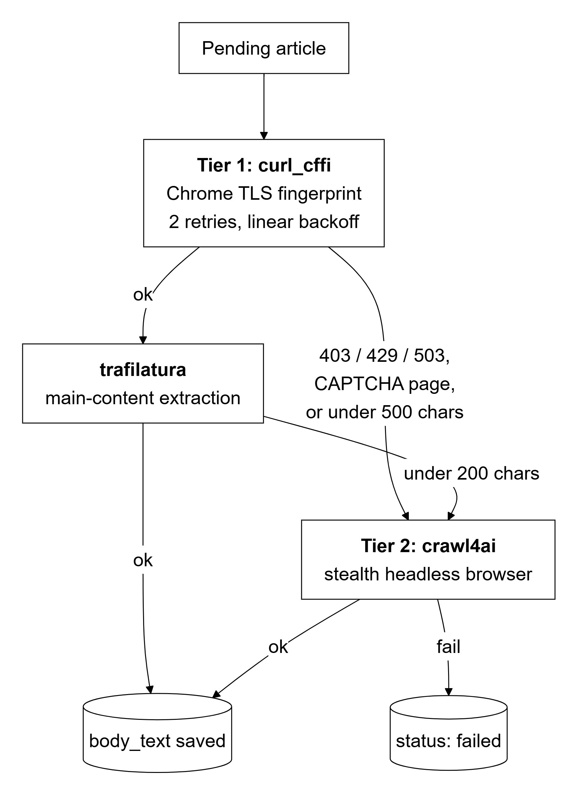
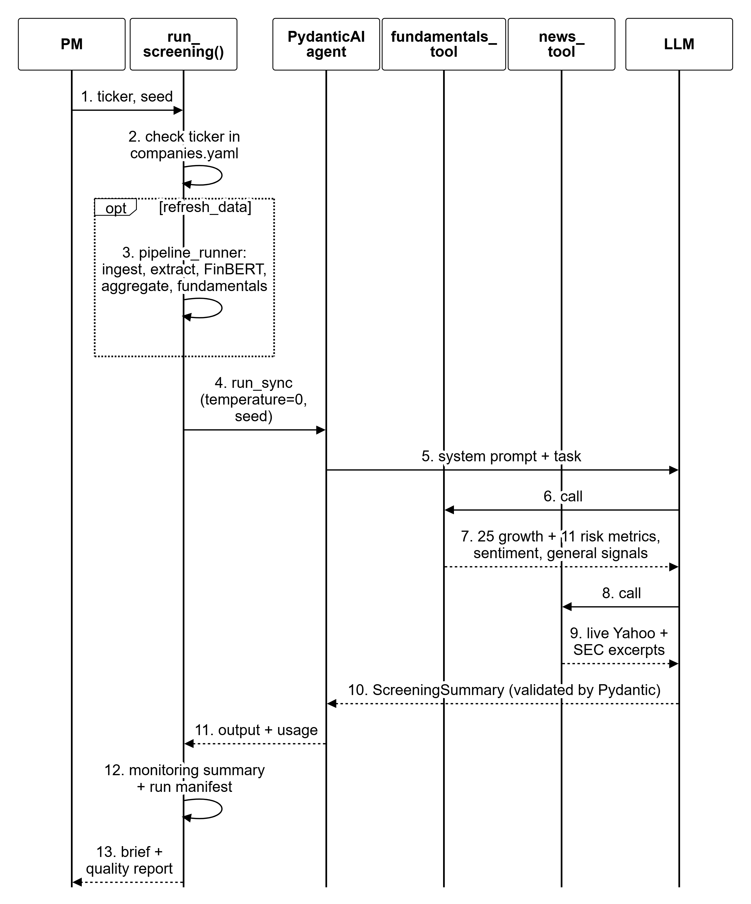

<div align="center">

# 📈 Equity Research AI

**An end-to-end equity screening system. It ingests SEC filings and financial news, scores them with FinBERT, computes 36 fundamental ratios from financial statements, and hands everything to a two-tool LLM agent that writes a screening brief for a Portfolio Manager.**


[What it does](#-what-it-does) · [Architecture](#-architecture) · [Quickstart](#-quickstart) · [Technical deep dive](#-technical-deep-dive) · [Agent design](#-the-screening-agent) · [Limitations](#-known-limitations--roadmap)

</div>

---

## 🎯 What it does

A Portfolio Manager picks a ticker. A few minutes later they get a structured brief that answers four questions:

| # | Question | Grounded in |
|---|----------|-------------|
| **Q1** | Is this company relevant to a **growth strategy** right now? | 25 growth fundamentals, each paired with sentiment from news matched to that metric |
| **Q2** | What are the **key positives and negatives** in recent news? | Live Yahoo Finance headlines and recent SEC 8-K / 6-K exhibits |
| **Q3** | What are the **financial highlights**? | Graded ratios for growth, profitability, capital efficiency and leverage |
| **Q4** | Are there **obvious risks or concerns**? | 11 risk fundamentals plus company-level news and filing signals |

> [!IMPORTANT]
> The agent never gives a buy, sell or hold call. Its verdict is limited to `Potentially relevant`, `Not clearly relevant` or `Insufficient data`. A separate evaluation step checks every output for recommendation language.

**Companies covered** (set in [`config/companies.yaml`](config/companies.yaml)): MercadoLibre (`MELI`), Global-E Online (`GLBE`), Apple (`AAPL`), Nvidia (`NVDA`), Coca-Cola (`KO`), Walmart (`WMT`), Pfizer (`PFE`), AT&T (`T`) and Duke Energy (`DUK`). US and foreign SEC filers, all non-financial.

---

## 🏗 Architecture

<p align="center">
  
</p>

The system runs as two layers:

1. **Data pipeline** ([`main.py`](src/equity_pipeline/main.py)): batch stages that can be run independently and safely re-run. They fill Postgres with raw documents, extracted text, sentiment scores, aggregated metric scores and graded fundamentals.
2. **Agent layer** ([`agent/`](src/equity_pipeline/agent/)): a PydanticAI agent with **exactly two tools**. It can optionally refresh the pipeline for one ticker before it answers.

---

## 🚀 Quickstart

### 1. Prerequisites

- Python **3.10+** (developed on 3.13)
- PostgreSQL 14+ (any version with `JSONB` and GIN indexes)
- An **OpenAI-compatible** LLM endpoint and API key
- Optional: a CUDA GPU. FinBERT then switches to FP16 automatically; it runs on CPU otherwise.
- For the per-metric news search: a local **SearXNG** container (Docker) with `formats: [html, json]` under `search:` in its `settings.yml`, reachable at `SEARXNG_URL`. Nothing else needs it.

### 2. Install

```bash
git clone https://github.com/aks861999/Equity-Research-AI.git
cd Equity-Research-AI
python -m venv .venv && source .venv/bin/activate   # Windows: .venv\Scripts\activate

pip install -r requirements-backend.txt   # the PC backend (everything); requirements.txt alone is the online app
crawl4ai-setup        # installs the headless browser for the fallback fetcher
```

### 3. Configure

Copy [`.env.example`](.env.example) to `.env` in the repo root and fill it in:

```dotenv
# PostgreSQL
POSTGRES_HOST=localhost
POSTGRES_PORT=5432
POSTGRES_DB=equity_research
POSTGRES_USER=postgres
POSTGRES_PASSWORD=change_me

# Any OpenAI-compatible endpoint (all three are required, there are no defaults)
MANAGED_LLM_API_KEY=sk-...
LLM_BASE_URL=https://your-llm-endpoint/v1
LLM_MODEL=your-model-name

# SEC EDGAR contact, sent as the User-Agent
SEC_USER_AGENT="Your Name your.email@example.com"

# full = your PC, every step. demo = the online dashboard (see "Online demo vs local backend")
APP_MODE=full
# Local SearXNG container for the news search
SEARXNG_URL=http://localhost:8888
```

> [!NOTE]
> The pipeline creates its tables on first run. If you have the database backup, restore it instead of ingesting from scratch:
> `pg_restore -d equity_research data/equity_research_backup.dump`

> [!WARNING]
> SEC EDGAR rejects requests without a real contact in the `User-Agent` header. Set `SEC_USER_AGENT` to your own name and email, or the SEC steps will return nothing.

Fundamentals need no files: they come from SEC filings through [OpenBB](https://docs.openbb.co)'s free `sec` provider (`pip install openbb-sec`, already in `requirements-backend.txt`; no API key, but `SEC_USER_AGENT` above must be set). Each company is fetched on first use and cached for a week in `data/sec/<TICKER>.json` (git-ignored). Refresh one with:

```bash
python scripts/data-prep/fetch_fundamentals.py MELI --refresh
```

**Adding a company** is one entry in `config/companies.yaml` (ticker and search name). To see what it would get first, run the coverage report, which touches no database:

```bash
python scripts/data-prep/coverage_report.py NEWTICKER
python scripts/data-prep/run_fundamentals.py          # calculate and store all 36 ratios
```

All data-preparation commands live in [`scripts/data-prep/`](scripts/data-prep/) and need no `PYTHONPATH`.

Only companies that file with the SEC are supported for now. A ticker that is not an SEC filer is skipped with a warning, and banks and insurers are skipped on purpose (see the limitations list).

### 4. Run

```bash
# Dashboard (recommended)
streamlit run apps/dashboard/streamlit_app.py

# Or the CLI: prints the brief, monitoring stats and quality checks
python scripts/run_screening.py --ticker MELI
python scripts/run_screening.py --ticker GLBE --no-refresh       # use what's already in Postgres (fast)
python scripts/run_screening.py --ticker MELI --no-news          # refresh everything except the slow news search
```

<details>
<summary><b>Running pipeline stages individually</b></summary>

<br/>

Every stage is idempotent, so re-running one only processes what is new or pending.

**Preparing the data for a company** (the order matters: each step reads what the one before stored):

```
python -m equity_pipeline.main --ticker T                      1  SEC filings + Yahoo headlines
python scripts/data-prep/run_fundamentals.py                   2  the 36 ratios (OpenBB / SEC)
python scripts/data-prep/fetch_news.py T --extract             3  per-metric news search, then the article texts
python -m equity_pipeline.main --run-sentiment                 4  FinBERT scores every readable, unscored text
python -m equity_pipeline.main --run-aggregation               5  per-metric sentiment (needs the scores of step 4)
python scripts/data-prep/fetch_news.py --report T              6  coverage of dates and what the quality gate rejected
python scripts/data-prep/data_status.py                        7  one table per company: what is stored, what is missing
```

`--extract` reads the pending texts of **every** ticker in the database, not only the one named. `data_status.py` is read-only and prints the command that fixes each gap it finds.

```bash
export PYTHONPATH=src          # PowerShell: $env:PYTHONPATH="src"

python -m equity_pipeline.main --ticker MELI             # ingest SEC + Yahoo for one ticker (omit --ticker for all)
python -m equity_pipeline.main --run-extraction          # fetch body text for every pending article
python -m equity_pipeline.main --run-sentiment           # FinBERT-score every extracted, unscored article
python -m equity_pipeline.main --run-aggregation         # build metric_scores
python -m equity_pipeline.main --run-fundamentals        # 25 growth ratios from SEC statements
python -m equity_pipeline.main --run-risk-fundamentals   # 11 risk ratios from SEC statements
python -m equity_pipeline.main --run-summary             # standalone LLM news summary per company

python -m equity_pipeline.read_example --ticker MELI     # read back what was ingested
```

</details>

---

## 🔬 Technical deep dive

### Stage 1: Multi-source ingestion

<table>
<tr><th>Source</th><th>Scope</th><th>What's interesting</th></tr>
<tr>
<td><b>SEC EDGAR</b><br/><a href="src/equity_pipeline/sources/sec_edgar.py"><code>sec_edgar.py</code></a></td>
<td>Company-level</td>
<td>
Reads the EDGAR Atom feed, parses each filing's index page and prefers <code>EX-99</code> exhibits (press releases) over the primary form.
Unwraps the <b>inline-XBRL viewer</b> iframe to reach the real document and strips <code>ix:*</code> tags, tables and hidden elements.
A <b>token-level digit-density heuristic</b> drops numeric fragments hidden in 1pt-font blocks.
Filings are treated as immutable: if a section is already stored, it is never downloaded again.
</td>
</tr>
<tr>
<td><b>News search (SearXNG)</b><br/><a href="src/equity_pipeline/sources/searxng_news.py"><code>searxng_news.py</code></a></td>
<td>Per-metric</td>
<td>
One search per growth metric, built from the key phrases in <a href="config/metrics.yaml"><code>metrics.yaml</code></a> as a <b>short query</b> ("MercadoLibre return on assets", a second phrase only if the first finds too few articles). The Google-style OR chains in the templates returned nothing on DuckDuckGo News. Risk metrics are not searched by default, because the agent does not read their per-metric sentiment. From all results of a query (typically 40-80), the same story on several sites counts once; results that name the metric in their title or snippet are ranked first and dated, newer articles next, but nothing is dropped for its keywords. The top 10 per metric are stored, because some pages cannot be read by the extractor or are junk. A <b>quality gate</b> (<a href="src/equity_pipeline/extraction/quality_gate.py"><code>quality_gate.py</code></a>) checks each downloaded text before it is kept: under 400 or over 100,000 characters, a short cookie-consent page, or a text that never mentions the company is rejected with a reason and never scored. How much an article is really about a metric is judged on its <b>full text</b> after extraction (<a href="src/equity_pipeline/extraction/metric_relevance.py"><code>metric_relevance.py</code></a>): a metric phrase in the title or opening weighs 1.0, later in the body 0.6, nowhere 0.2. Queries go to a <b>local SearXNG container</b> that asks DuckDuckGo News, Brave News and Bing News. Google News and Reuters block automated access and are switched off in its <code>settings.yml</code>.
Results are <b>real article URLs</b>, so the old redirect-decoding step is gone. One story that matches several metrics is stored once with all its metrics.
No time filter is sent (SearXNG then drops DuckDuckGo and Brave): dated articles older than a year are discarded and the sentiment time decay down-weights the rest. Only DuckDuckGo returns a publish date; for the others the date is read from the article page during text extraction (<code>htmldate</code>: JSON-LD, meta tags, <code>&lt;time&gt;</code>, URL), and an article with no date anywhere is weighted as 30 days old. A complete answer is cached for the day, and queries are spaced 8-14 seconds apart (Brave News rate-limits faster requests), so a company takes about 5-9 minutes. Run it with <a href="scripts/data-prep/fetch_news.py"><code>scripts/data-prep/fetch_news.py</code></a>.
</td>
</tr>
<tr>
<td><b>Yahoo Finance</b><br/><a href="src/equity_pipeline/sources/yahoo_finance.py"><code>yahoo_finance.py</code></a></td>
<td>Company-level</td>
<td>Prefers <code>canonicalUrl</code> over <code>clickThroughUrl</code>, because tracking parameters change from run to run and would break deduplication.</td>
</tr>
</table>

### Stage 2: Stable identity and idempotent upserts

The same article reaches the system through different redirect wrappers and tracking-parameter variants. Document IDs are therefore built from a **canonicalised** URL ([`dedup.py`](src/equity_pipeline/ingestion/dedup.py)):

```
lower-case scheme + host  →  strip utm_*, fbclid, gclid, ocid, …  →  sort query params  →  drop fragment
        →  SHA-256  →  article:{ticker}:{hash}
```

[`upsert.py`](src/equity_pipeline/ingestion/upsert.py) applies a **read → update_fn → write** pattern. When an existing article is found again by a new metric query, the new `metric_id` is appended to its `matched_metrics`. Body text and sentiment are never overwritten. Each field has a single owner: ingestion never touches `sentiment`, and the sentiment stage writes only `sentiment`.

### Stage 3: Storage — a document store on PostgreSQL

[`postgres_client.py`](src/equity_pipeline/db/postgres_client.py) started as a CouchDB client and was migrated to Postgres without changing its interface. Documents live in a single `articles (id TEXT PK, doc JSONB)` table with a **GIN index** and expression indexes on `(type, ticker)`, `(type, extraction.status)` and similar fields. A small translator turns Mango-style selectors (including dotted paths and `$elemMatch`) into JSONB `@>` containment queries. Aggregated outputs go into ordinary relational tables (`metric_scores`, `fundamental_metrics`) using `ON CONFLICT DO UPDATE`.

### Stage 4: Resilient body-text extraction

[`article_extractor.py`](src/equity_pipeline/extraction/article_extractor.py) uses a two-tier fetch strategy:

<p align="center">
  
</p>

Block detection combines HTTP status codes, 11 anti-bot page markers and a minimum content length. The expensive browser only starts when the cheap path fails. In the online demo the browser is never allowed: a page that `curl_cffi` cannot read is set aside as `needs_browser` and the backend reads it later.

Every extracted text then goes through the **quality gate** ([`quality_gate.py`](src/equity_pipeline/extraction/quality_gate.py)), the same four checks for every site: too short (under 400 characters), too long (over 100,000), a cookie-consent page, or a text that never names the company. A rejected article keeps a small marker (`status: rejected` plus the reason), so it is not downloaded again, and is never scored. The company is matched on its configured search name as whole words (so `AT&T` does not match "attention"), or on a ticker of three or more letters.

| Extraction status | Meaning |
|---|---|
| `pending` | stored, text not read yet |
| `success` | text stored and usable |
| `rejected` | read, but failed the quality gate (reason stored) |
| `failed` | the page could not be read; not retried |
| `needs_browser` | only the browser can read it; set aside by the demo, retried by the backend |

### Stage 5: FinBERT sentiment with relevance weighting

[`sentiment.py`](src/equity_pipeline/extraction/sentiment.py) runs [`ProsusAI/finbert`](https://huggingface.co/ProsusAI/finbert):

- **Long-document handling.** Text is split into 512-token windows with a 50-token overlap, scored in padded batches of 32 under `torch.inference_mode()` (FP16 on CUDA), then averaged with **weights proportional to chunk length**.
- **Score.** `P(positive) − P(negative)`, in the range −1 to +1.
- **Relevance.** `1.0` if the company appears in the title, `0.8` if it appears in the first ~1,000 characters, `0.2` otherwise. This down-weights articles that only mention the company in passing.

### Stage 6: Time-decayed aggregation per metric

[`run_aggregation.py`](src/equity_pipeline/extraction/run_aggregation.py) groups scored articles by `(ticker, metric_id)`. An article that matched several metrics counts toward each of them.

```math
w_i = \text{relevance}_i \cdot e^{-\lambda \cdot \text{days ago}_i} \cdot \text{metric relevance}_i, \qquad \lambda = 0.05
```

where the metric relevance is 1.0 when the article names the metric in its title or opening, 0.6 later in the body and 0.2 when it never names it (see Stage 1).

```math
\text{weighted sentiment} = \frac{\sum_i w_i \, s_i}{\sum_i w_i}
```

With λ = 0.05, a 30-day-old article carries about 22% of the weight of one published today. Each row also stores **dispersion** (standard deviation of the raw scores) and **volume** (number of articles), so the agent can tell strong agreement from thin or contradictory evidence. Only articles found by a metric query carry a metric, so Yahoo headlines do not enter these scores; they reach the agent through the company-level sentiment instead. The aggregation is recomputed from all scored articles on every run, and the weighted mean does not change when time passes without new articles (the decay shrinks every weight equally), so a metric's score is never marked stale by itself. Volume and dispersion are not weighted by age (see the limitations).

### Stage 7: Fundamentals and threshold grading

[`run_growth_fundamentals.py`](src/equity_pipeline/extraction/run_growth_fundamentals.py) and [`run_risk_fundamentals.py`](src/equity_pipeline/extraction/run_risk_fundamentals.py) compute ratios from SEC statements and grade them **Red / Yellow / Green** against fixed thresholds.

[`sec_fundamentals.py`](src/equity_pipeline/sources/sec_fundamentals.py) fetches annual income statements and balance sheets through OpenBB. They arrive in full currency units with the reporting currency on every row, and the calculators read OpenBB's field names directly (`total_revenue`, `total_assets`, ...), so there is no field-mapping layer and no unit conversion. The latest fiscal year is whatever the filing says it is, rather than a fixed year.

Every input goes through the same **fallback chain**, so a new company needs no code: the OpenBB field, then an ordered list of raw XBRL tags from the SEC companyfacts API, then a derivation from other fields, and otherwise it stays empty ("not found", never guessed). Anything that did not come straight from OpenBB is recorded with its source, and sanity checks (balance sheet identity, gross profit not above revenue, ...) are recorded as warnings. The coverage report prints both. The rules were checked against the raw tags on 12 companies and then run on 26 more (MSFT, AMZN, TSLA, BA, GE, SO, NEE, F and others): 20 of the 26 computed 24 or more of the 25 growth ratios and all 11 risk ratios. Most remaining gaps are lines the filing does not contain (gross profit for utilities and telecoms, operating income for pharma). The real adapter limits are gross PP&E for GE and SO, and Ford's debt, which the SEC API does not expose.

- **Long-term debt.** For some filers OpenBB gives the non-current part (AAPL, KO), for others the total including the current part (T, MELI). The current part is removed only when OpenBB's figure equals the filer's total-debt tag. When OpenBB has no debt at all, raw debt tags are tried.
- **Missing debt is empty, not zero** when the filer reports interest expense, so a company that clearly has debt is never graded debt-free (Ford reports debt only by segment, which the SEC API does not expose). A filer with no debt facts and no interest expense at all is treated as debt-free and labelled `assumed_zero` (GLBE).
- **Interest expense** falls back to raw expense tags, then to cash interest paid as a labelled proxy (MELI, CAT, GE, NEE). EBIT is pretax income plus interest expense, or pretax income alone, flagged, when none is found (AAPL).
- **Banks and insurers are skipped.** Interest is their revenue and cost of funds, so EBIT margin, liquidity and leverage ratios would be wrong (JPM's EBIT margin came out at 93%).

<details>
<summary><b>All 36 metrics</b></summary>

<br/>

| Theme | Metrics |
|---|---|
| **Growth** | Revenue CAGR (2-year), EBIT growth, net income growth, asset growth |
| **Profitability** | Gross, operating, EBIT, EBITDA and net margin; SG&A-to-revenue |
| **Capital efficiency** | ROE, ROA, ROIC (NOPAT ÷ average invested capital, using the effective tax rate with a 20% fallback), asset turnover |
| **Funding & reinvestment** | Sustainable growth rate (ROE × retention), reinvestment rate, approximate FCF, capex-to-sales |
| **Leverage & liquidity** | Debt/equity, debt/assets, net debt/EBITDA, current, quick and cash ratios, interest coverage |
| **Risk** | Altman Z'' score, debt/equity, total liabilities/assets, net debt/EBITDA, short-term debt share (refinancing risk), current and quick ratios, interest coverage, retained earnings/assets, non-recurring items/pretax income (earnings quality), intangibles/assets |

Example thresholds: revenue CAGR is 🔴 below 10%, 🟡 at 10–15% and 🟢 at 15% or more. Net debt/EBITDA is 🔴 above 4×. The current ratio is graded as a **band**: below 1.0 or above 2.5 is 🔴, because excess idle liquidity is also a warning sign.

The risk theme includes the **Altman Z'' score**, the non-manufacturer version of Altman's distress model: `6.56·WC/TA + 3.26·RE/TA + 6.72·EBIT/TA + 1.05·BookEquity/TotalLiabilities`. It uses book equity instead of market capitalisation, so it needs no price data and is applied to every company. Above 2.6 is 🟢, 1.1–2.6 is 🟡 and below 1.1 is 🔴. Higher is safer, the opposite of most other risk ratios.

</details>

---

## 🤖 The screening agent

Built with **PydanticAI** in [`screening_agent.py`](src/equity_pipeline/agent/screening_agent.py).

<p align="center">
  
</p>

### Design decisions

| Decision | Why |
|---|---|
| **Exactly two tools** | A hard requirement. Each tool can still run several queries internally, which keeps the agent's choices simple without starving it of context. |
| **Pipeline refresh happens *before* the agent, not as a third tool** | The data is fresh, the two-tool limit holds, and the model never decides whether to scrape. |
| **Both tools read the database, none calls the network** | The refresh step stores what is new, then the agent reads it. The sources table in the dashboard shows exactly what the model saw, and a run with the refresh switched off is repeatable. |
| **The period travels with the ratios** | Each ratio row carries the fiscal year end and currency, and the prompt states them, so the brief never compares a September year end with a December one as if they were the same year. |
| **Structured output (`ScreeningSummary`)** | Pydantic validates the LLM's answer and PydanticAI retries when it doesn't match the schema. The UI renders fields instead of parsing free text. |
| **Every metric includes a definition and a "good direction"** ([`metric_definitions.py`](src/equity_pipeline/agent/metric_definitions.py)) | A bare `m13_roic = 0.0421` invites misreading. Static descriptions add context without adding randomness. |
| **`None` stays `None`** | Risk metrics have no per-metric sentiment, and the schema keeps it that way instead of filling in zeros. The prompt tells the model to report missing data rather than treat it as neutral. |
| **Unknown tickers fail fast** | `get_company()` raises *before* any network or LLM call. |
| **Live calls never crash a run** | Yahoo and SEC failures in the tools are logged and turned into empty results. |

### Monitoring, reproducibility and quality checks

<table>
<tr>
<td width="33%" valign="top">

**📊 Monitoring**<br/>[`monitoring.py`](src/equity_pipeline/agent/monitoring.py)

Counts tool calls per tool with timestamps (PydanticAI doesn't track these) and records LLM requests and token usage from `RunResult.usage`. Wall-clock time is captured for every run.

</td>
<td width="33%" valign="top">

**🔁 Reproducibility**<br/>[`reproducibility.py`](src/equity_pipeline/agent/reproducibility.py)

Addresses three separate sources of drift:
- *Sampling*: `temperature=0`, near-zero `top_p`, fixed `seed`
- *Prompt or schema changes*: a `PROMPT_VERSION` stored in each manifest
- *Data changes*: a hash of what each tool returned (fetch timestamps excluded), stored per tool and combined, so a changed hash shows whether the metrics or the live news moved

Every run writes `run_manifests/<ticker>_<ts>_<uuid>.json`.

</td>
<td width="33%" valign="top">

**✅ Quality evaluation**<br/>[`evaluation.py`](src/equity_pipeline/agent/evaluation.py)

Twelve deterministic checks that cost nothing to run, on the generated text:
1. All four answers present
2. Positives and negatives present
3. No buy/sell/price-target language
4. Verdict is one of the allowed values
5. Answer lengths are within sane bounds
6. **Groundedness**: at least 60% of numbers cited trace back to a tool value or to the supplied news and filing text (±5%, ratio or percent)
7. Metric coverage: at least 15 of 25 growth and 6 of 11 risk metrics have data
8. **A number matches its metric**: a figure written next to a metric name must be that metric's own value (or its sentiment figures), with the right sign
9. **No number for a missing metric**: a metric with no value gets no figure
10. **Grade wording**: a Red metric is not called strong, a Green one not weak
11. **Risk flag count**: `risk_flag_count` equals the number of risk metrics graded Red (the run also replaces the model's count with the real one and records a difference)
12. **No unsupported explanations**: words that explain a figure or describe a trend (decelerating, flattered, buybacks, ...) must appear in the news or filing text the model was given; the ratios are one annual snapshot

Checks 8 to 10 attach a number to a metric only when it clearly follows or precedes the metric's name; anything ambiguous is skipped, so a pass means "nothing wrong found", not "everything verified". An optional offline LLM judge is also provided.

</td>
</tr>
</table>

### A real run

From the AAPL run `AAPL_20261109T164906Z_46698298` (`--no-refresh`, so only stored data):

```jsonc
{
  "prompt_version": "screening-agent-v8",
  "model_name": "deepseek-ai/DeepSeek-V4.1-Flash",
  "monitoring": {
    "tool_calls_by_name": { "fundamentals_tool": 1, "news_tool": 1 },
    "llm_calls_total": 2,
    "llm_total_tokens": 12157,
    "wall_clock_seconds": 41.78
  },
  "final_output": {
    "growth_relevance_verdict": "Potentially relevant"
  }
}
```

The brief states the fiscal year it describes (year ended 2026-09-26, USD), flags the one missing ratio (interest coverage) instead of guessing it, and calls thin sentiment (a volume of 2 or 4 articles) a weak signal.

---

## 🌐 Online demo vs local backend

The same code runs in two modes, set by `APP_MODE` in `.env`:

| | `full` (your PC, the backend) | `demo` (the online dashboard) |
|---|---|---|
| SEC EDGAR filings, Yahoo Finance headlines | live | live |
| Article text | `curl_cffi`, with the `crawl4ai` browser as fallback | **`curl_cffi` only**; a page that needs the browser is set aside as `needs_browser` and read later by the backend |
| Per-metric news search (SearXNG) | yes, run manually (`scripts/data-prep/fetch_news.py`) | never |
| FinBERT scoring and aggregation | yes | never: read from the shared database |
| Financial ratios (OpenBB) | calculated and stored | read from the database |
| Companies | any in `companies.yaml` | the configured ones only |
| Install | `requirements-backend.txt` | `requirements.txt` (no torch, no browser library, no OpenBB) |

The demo dashboard shows a notice with what is live and when the prepared data was last updated (search news, sentiment scores, the fiscal year and date of the ratios). The brief the LLM writes uses the stored ratios and per-metric sentiment plus the newest Yahoo headlines (with the text of the company-specific ones) and the SEC filing excerpts. Both tools read the database: the live refresh step fetches SEC EDGAR and Yahoo Finance once and stores what is new, then the agent reads it, so with the refresh switched off the brief uses what was stored last.

**New Yahoo articles in the demo.** They are stored with their text (read with `curl_cffi`), but not scored: FinBERT is never loaded online. The agent sees such an article as a headline with a text lead of about 900 characters (only if it is about the company, for the first five). It sees no sentiment value for it, and the company-level Yahoo sentiment counts only articles already scored. A page that needs the browser stays `needs_browser` and the agent sees only its headline, until the backend reads and scores it (`fetch_news.py --extract`, then `--run-sentiment`).

### The online app

```
  Visitor's browser ──► Web terminal (apps/web, Vite + React, hosted on Vercel)
                              │  reads results directly (public "anon" key, read-only by row-level security)
                              ▼
                        Supabase Postgres  ◄──── publish script ◄──── your PC: the full backend and local database
                              ▲                    (scripts/online/publish_to_supabase.py)
                              │  writes progress and the finished brief
                        Streamlit worker (apps/dashboard, APP_MODE=demo, Streamlit Community Cloud)
                              ▲
                              └── opened in a hidden frame by the web terminal for "RUN SCREENING":
                                  ?autorun=1&ticker=MELI&seed=42&refresh=1&nonce=<per click>
```

| Part | Where | What it does |
|---|---|---|
| Prepared data | your PC, then **published** to Supabase | ratios, search news, FinBERT scores, metric scores (the heavy work, done offline) |
| Web terminal | `apps/web` on Vercel | reads the tables and views with the public key; the RUN button starts the worker and **polls** `screening_runs` until its nonce appears |
| Worker | `apps/dashboard` on Streamlit Community Cloud, `APP_MODE=demo` | fetches live SEC EDGAR and Yahoo headlines, runs the agent, writes each step and the result to `screening_runs` |
| Keep awake | `.github/workflows/keep_awake.yml` | opens the worker in a headless browser twice a day (best effort) |

**Safety rules:** the browser can only read (`database/supabase_rls.sql`; the `articles` table, which holds full texts, is closed and only two views over it are readable); all writes come from Python over a direct database connection; the worker allows one run per ticker at a time and reuses a result younger than 5 minutes, so the public app cannot be used to run the language model in a loop.

**Set up, once:**

```
1  Create a Supabase project; copy the "session pooler" connection string into TARGET_DATABASE_URL (.env)
2  python scripts/online/apply_schema.py --target-url "<url>" --rls          # tables, views, read-only rules
3  python scripts/online/publish_to_supabase.py --dry-run                    # then without --dry-run
4  Streamlit Community Cloud: main file apps/dashboard/streamlit_app.py; secrets: APP_MODE=demo,
   POSTGRES_HOST/PORT/DB/USER/PASSWORD + POSTGRES_SSLMODE=require (the Supabase values),
   SEC_USER_AGENT, LLM_BASE_URL, LLM_MODEL, MANAGED_LLM_API_KEY
5  Vercel: root directory apps/web; variables VITE_SUPABASE_URL, VITE_SUPABASE_ANON_KEY, VITE_STREAMLIT_WORKER_URL
6  GitHub: repository secret STREAMLIT_APP_URL (for the keep-awake workflow)
```

**After every data update on your PC:** `--run-sentiment`, `--run-aggregation`, `run_fundamentals.py`, then `publish_to_supabase.py`.

> [!IMPORTANT]
> The public worker spends your LLM key. Use an endpoint that is reachable from the internet and a key with a spending limit. An endpoint that only works inside your organisation will not work from Streamlit Community Cloud.

---

## 📁 Project structure

```
.
├── apps/
│   ├── dashboard/streamlit_app.py   # PM dashboard + the headless worker of the web terminal
│   └── web/                         # the web terminal: Vite + React + TypeScript, reads Supabase (Vercel)
├── src/equity_pipeline/             # the Python package (below)
├── config/
│   ├── companies.yaml               # tickers allowed for screening, SEC form type, search name
│   └── metrics.yaml                 # 36 metric definitions + news search query templates
├── database/
│   ├── schema.sql                   # tables and the two read-only views
│   └── supabase_rls.sql             # Supabase only: browser = read-only
├── scripts/
│   ├── run_screening.py             # CLI: brief + monitoring + quality report
│   ├── data-prep/                   # fetch_news · run_fundamentals · coverage_report · data_status · quality_gate …
│   ├── online/                      # apply_schema · publish_to_supabase
│   └── agent/                       # list_llm_models (which models the endpoint offers)
├── tests/                           # offline tests: inputs, news, quality gate, agent checks, demo mode, storage, run store
├── docs/diagrams/                   # README diagrams: PNGs, Mermaid sources, render.py
├── archive/google_news/             # the retired Google News fetcher, kept for reference
├── .github/workflows/               # keep_awake.yml
├── .streamlit/config.toml           # Streamlit settings (stays at the root: Streamlit reads it from there)
├── requirements.txt                 # the ONLINE app (what Streamlit Community Cloud installs)
├── requirements-backend.txt         # the PC backend = requirements.txt + torch, crawl4ai, openbb, ...
├── .env.example                     # every setting, documented
├── data/                            # SEC statement cache, search query cache, DB dumps (git-ignored)
└── run_manifests/                   # one JSON per agent run (git-ignored)

src/equity_pipeline/
├── main.py                          # pipeline CLI: --run-extraction, --run-sentiment, ...
├── config.py                        # the only module that reads .env / YAML
├── sources/                         # sec_edgar · sec_fundamentals · inputs · coverage · searxng_news · yahoo_finance
├── ingestion/                       # dedup · upsert · queries · time_utils
├── db/                              # PostgresClient (JSONB document store)
├── extraction/                      # article_extractor · quality_gate · sentiment · aggregation · fundamentals
└── agent/                           # screening_agent · schemas · data_access · pipeline_runner · run_store
                                     # monitoring · reproducibility · evaluation · metric_definitions
```

[`config.py`](src/equity_pipeline/config.py) is the only module that reads configuration from disk; every other module takes plain arguments, so each one can be tested in isolation.

---

## 🧰 Tech stack

| Layer | Tools |
|---|---|
| Data sources | SEC EDGAR, OpenBB (`openbb-sec`), `yfinance`, a local SearXNG container (DuckDuckGo, Brave and Bing news) |
| Scraping & parsing | `requests`, `feedparser`, `BeautifulSoup`, `curl_cffi` (TLS impersonation), `crawl4ai` (Playwright), `trafilatura`, `htmldate` (publish dates) |
| Storage | PostgreSQL (`JSONB`, GIN and expression indexes), `psycopg2` |
| NLP | PyTorch, Hugging Face `transformers`, FinBERT |
| Numerics | `pandas`, `numpy` |
| LLM & agents | PydanticAI, `instructor`, OpenAI-compatible API |
| UI | Streamlit |

---

## 🧭 Known limitations & roadmap

The gaps below are known, not oversights.

- [ ] **Non-US companies are not supported yet.** Fundamentals come from SEC filings, so a European or Japanese ticker added to `companies.yaml` would get news and sentiment but no fundamentals. ESEF (EU) and EDINET (Japan) are the free official sources to add next.
- [ ] **Banks and insurers get no fundamentals,** because the industrial ratios do not apply to them. They need their own metric set (net interest margin, capital ratios, combined ratio).
- [ ] **ROIC can be extreme** for buyback-heavy or net-cash companies (AAPL about 104% and NVDA about 120% in the latest test run), because invested capital is debt plus equity minus cash and shrinks toward zero. A definition that handles this is needed.
- [ ] **D&A can be low for some filers.** OpenBB's `depreciation_and_amortization` already includes amortization for most (AAPL, NVDA, JPM), but GLBE tags only depreciation under that name, so its EBITDA margin is slightly understated.
- [ ] **The per-metric news search is off by default** in `main.py` (`--with-news` turns it on; it is the slowest step). In the dashboard it is a checkbox in full mode, and never available in the demo.
- [ ] **Brave and Bing results carry no publish date.** The date is read from the article page, which fails for blocked or paywalled pages; those articles are weighted as 30 days old (`UNKNOWN_DATE_AGE_DAYS`). `fetch_news.py --report` shows how many articles fall in each case.
- [ ] **Fundamentals use single-period snapshots.** Trend and peer-relative grading for metrics marked "Ungraded" is not built yet.
- [ ] **Tests are offline scripts, not a CI suite.** `tests/` covers the inputs, the news search, the quality gate, the agent checks and the demo mode, run by hand (`python tests/test_<name>.py`). Nothing runs them automatically yet.
- [ ] **The aggregation reads every scored article of every ticker, with no age limit** (`LIMIT 100000`). Old articles carry almost no weight in the weighted mean, but `volume` and `dispersion` count them all, and the cost grows with every run. A window of about the last 90 days is planned.
- [ ] **The quality gate matches the configured search name as a whole.** A company usually written in a shorter form than its configured name loses articles wrongly: 62% of Global-E Online's stored articles were rejected as "company not mentioned", against 15% for Apple. An alias list per company is the planned fix.
- [ ] **Which Yahoo items count as "about the company"** (the name in the title, or at least 3 mentions and 10 per 1,000 words) was tuned on four MercadoLibre articles only.
- [ ] **Per-metric sentiment is article-level.** About half of the article-metric pairs (908 of 1,699 in the latest run) name no metric in their text and are weighted 0.2; sentence-level scoring would be more precise.
- [ ] **The quality evaluation is rule-based.** It checks numbers per metric, missing data and wording, but not whether the verdict is right or a news claim is supported. A claim-level judge and perturbation tests (blank or flip an input and check the brief changes) are the next steps.
- [ ] **Fiscal years differ between companies** (AAPL ends in September, NVDA and WMT in January, the rest in December); each brief states its own period, but a side-by-side comparison does not align them.

---

<div align="center">

**⚠️ Disclaimer:** This project produces initial screening output for early-stage evaluation only. It is not investment advice, a recommendation, or a final investment decision.

</div>
